::: {.hero .hero-logo}

#baltimoreisfunny

# What is this?

:::

## Purpose 

**Building community through comedy**

Comedy has the power to connect the community through laughter. Baltimore Comedy.org attempts to support the local comedians yielding this power. 

This is a free, centralized platform connecting Baltimore-area comedy audiences with comedians, shows, and open mics. 

Baltimore's local comedians are as talented as anyone appearing on a Netflix special or HBO special. Why haven't you heard of them then? It's because a local comedian does have the financial or administrative backing comparable to some Hollywood headliner. At BaltimoreComedy.org we attempt to meet this gap by using teamwork and community (It's incredibly corny but nonetheless). 

Baltimore Comedy.org operates on a principle of open access and zero gatekeeping. Anyone in the Baltimore area who claims they participate in comedy can be listed. We don't care how new you are to the game as long as you share the values of building community connections through comedy. 

We believe in Baltimore. 

# How to Participate — For Comedians

BaltimoreComedy.org is free, open to anyone, and zero gatekeeping involved. 

You promote Baltimore Comedy.org community, we in turn promote you. 

---

## Step 1. Get Listed

This is the baseline — it's what makes you findable at all.

**What it gets you:** a profile on the Comedians page (bio, style,
socials) and your shows on the calendar, all searchable by anyone
looking for local comedy.

**How:** fill out the Add a Comedian form and/or Add a Show form at
[BaltimoreComedy.org/submit](https://baltimorecomedy.org/submit.qmd).
Takes a minute or two.

**What happens after:** every submission gets reviewed before it goes
live — not for "is this comedian funny enough?" just for basic completeness (real
links, working info, you're a real person). 

<a class="cta-button" href="submit.qmd">Add Your Comedian Profile →</a>

---

## Step 2. Send a Hype Clip

Once you're listed, you can DM a short video hyping up the Baltimore
comedy scene — we'll publish it under Baltimore Comedy.org's own
branding and promote it through our channels.

**What makes a good clip:** Right now we don't have money, so the bar is low.
The video can be whatever you'd like it to be. But ideally it will showcase YOU and your comedy. 
Lastly please end off with a plug about BaltimoreComedy.org. Or DM your video to
[@baltimore_comedy_org](https://instagram.com/baltimore_comedy_org)
on Instagram and we'll add the plug. 

---

## 3. Get Auto-Reposted Going Forward

Once you've sent one hype clip, DM or tag
**@baltimore_comedy_org** on any future event posts and we'll
automatically repost them. But the event must take place within an hour's drive
of Baltimore. 

---

#### Who is doing this? 

Candace (Candy) Savonen (candyscomedybaltimore@gmail.com) is the creator of BaltimoreComedy.org. She has run training programs, written grants, and is a working comedian. She has witnessed who gets stage time and who quietly stops showing up. Off stage, she is a data engineer and has built online courses for a living. She created and maintains OTTR (the course building tool). She has extensive experience in the non profit education space and has developed courses for the ITCR Training Network and Alex's Lemonade Stand Foundation, and worked on the curriculum at DataTrail, a Baltimore nonprofit that teaches data science to city youth. She also built and runs the BaltimoreComedy.org website. 
---

*Questions about any of this? Interested in supporting us? 
Reach out to candyscomedybaltimore@gmail.com or DM @baltimore_comedy_org on insta*

