::: {.hero .hero-logo}

#baltimoreisfunny

  <a class="cta-button filled" href="shows.qmd">See Upcoming Shows</a>
  <a class="cta-button" href="comedians.qmd">Find a Comedian</a>

:::

::: {#comedy-map .home-map}
<h3 style="text-align:center; margin-bottom:0.8rem;">Where are the jokes?</h3>

<!--
The Comedy Map. Pins come from _generated/openmics-map.qmd, built by
scripts/generate_content.py -> build_map_content. Hovering a pin shows
what's there; clicking it goes to that mic's row on the Open Mics page or
to the Shows calendar (a small chooser if a venue has both).
-->

<link rel="stylesheet" href="https://unpkg.com/leaflet@1.9.4/dist/leaflet.css" />

Open mic
Show
Mic details may have changed
Mic may have ended



:::

::: {.grid}

::: {.g-col-6}
### 🎤 Find Shows
Open mics, showcases, and one-off specials around the city, listed with
dates.
:::

::: {.g-col-6}
### 🎭 Find Comedians
A growing roster of Baltimore-area comics, with bios and links to their
socials.
:::

:::

<a class="cta-button" href="submit.qmd">Add Your Show or Profile →</a>

